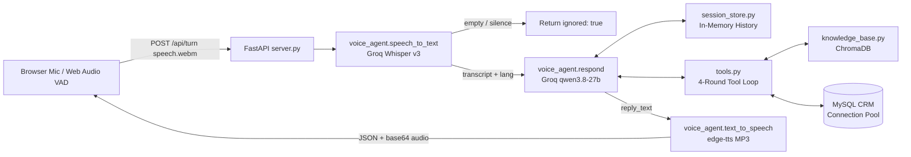
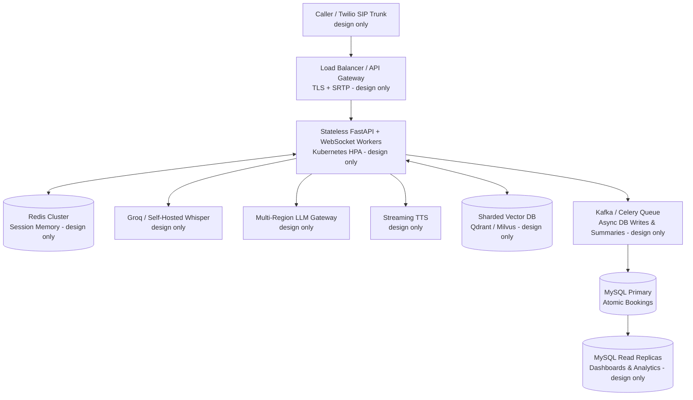

# System Architecture

## 1. Real MVP System (Implemented)

The MVP runs as a FastAPI server ([server.py](../server.py)) serving a single-page hands-free web UI ([static/index.html](../static/index.html)), with a Streamlit fallback UI ([app.py](../app.py)).

- **Browser (`static/index.html`):** Captures microphone audio via Web Audio API (`AudioContext` + `AnalyserNode`), calibrates room noise after a 450 ms delay, detects speech using RMS thresholds, records `audio/webm` via `MediaRecorder`, and enforces half-duplex (mic ignored while Aria speaks).
- **API Layer (`server.py`):** Exposes `/api/start`, `/api/turn`, `/api/end`, and `/api/db`.
- **Voice & Agent (`voice_agent.py`):**
  - `speech_to_text(audio_bytes, filename)` sends audio to Groq `whisper-large-v3`, filters silence/hallucinations, and maps language to `en` or `hi`.
  - `respond(session_id, user_text, detected_language)` appends to `session_store`, calls Groq `qwen/qwen3.8-27b` with up to 4 tool-calling rounds (`tools.py`), and returns the reply.
  - `text_to_speech(text, language)` synthesizes MP3 bytes via `edge-tts`.
- **RAG (`knowledge_base.py`):** Queries local ChromaDB (`chroma_db/`) using `paraphrase-multilingual-MiniLM-L12-v2` embeddings.
- **Database / CRM (`db.py`):** Uses a `MySQLConnectionPool` (`pool_size=15`) against MySQL (`leads`, `availability_slots`, `appointments`, `call_summaries`) with atomic slot booking (`UPDATE ... WHERE is_booked = 0`).

### MVP Data Flow

---

## 2. Production Architecture for 1,00,000 Users (Design Only)

Everything below marked *(design only)* is **not** implemented in this repository.

### Concurrency Sizing Method (No Invented Numbers)

$$\text{Average Concurrent Calls} = \frac{\text{Calls per Day} \times \text{Average Call Minutes}}{1440}$$

$$\text{Peak Concurrent Calls} = \text{Average Concurrent Calls} \times \text{Peak Factor}$$

Worker pods, Redis memory, and MySQL pool size are provisioned for **Peak Concurrent Calls**.

### What Breaks First at Scale & Fixes

1. **LLM & STT Rate Limits (429 Too Many Requests):**
   - *Why:* Single-account API quotas (e.g., tokens-per-minute limits) throttle burst traffic.
   - *Fix:* Multi-key/multi-provider LLM gateway with circuit breakers, prompt caching, and self-hosted Whisper/vLLM autoscaling.
2. **Database Connection Exhaustion:**
   - *Why:* Each worker holds a local connection pool; hundreds of pods exhaust `max_connections`.
   - *Fix:* Route writes through a proxy (ProxySQL / RDS Proxy), offload non-critical writes and call summaries to Kafka/Celery, and serve reads from MySQL replicas.
3. **Embedding Model Memory:**
   - *Why:* Loading `SentenceTransformer` inside every worker duplicates RAM per pod.
   - *Fix:* Isolate embeddings into a dedicated inference microservice or hosted embedding API backed by a sharded vector DB.
