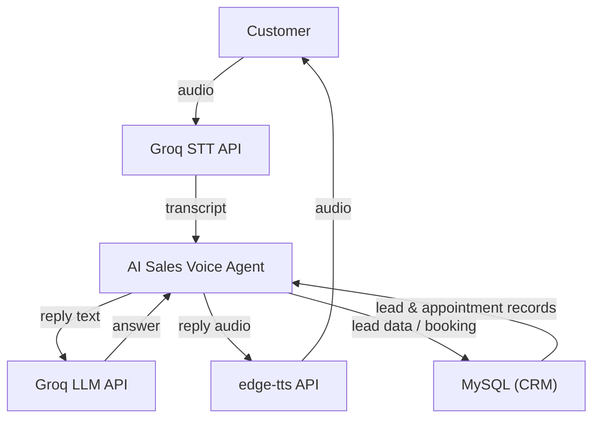
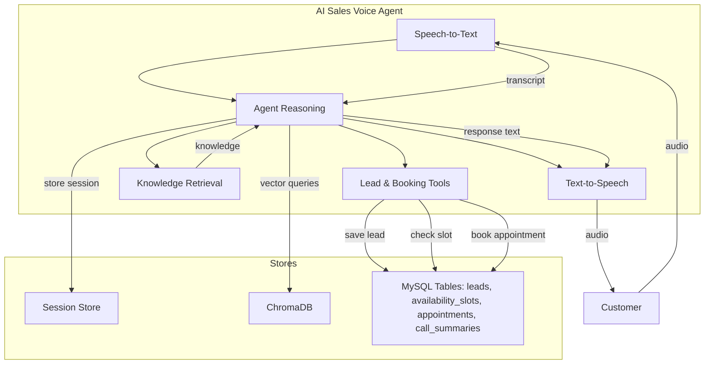
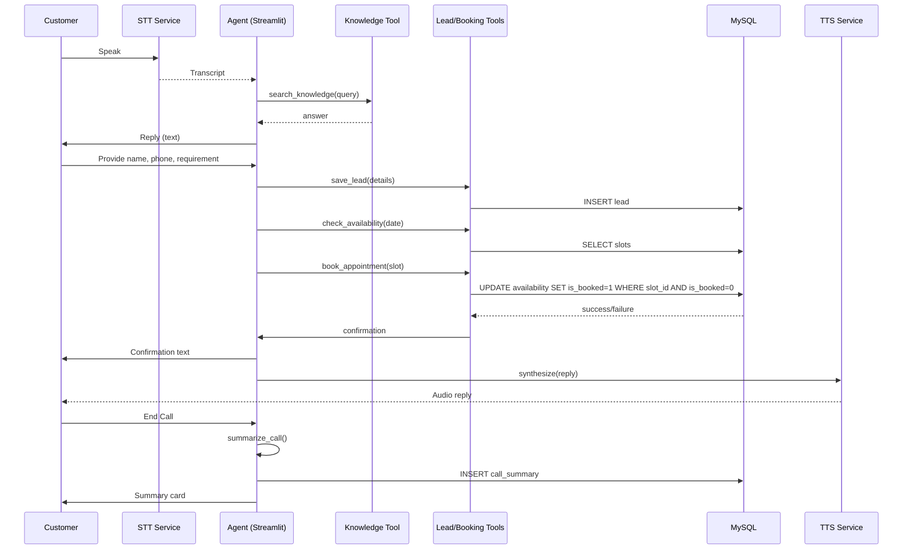
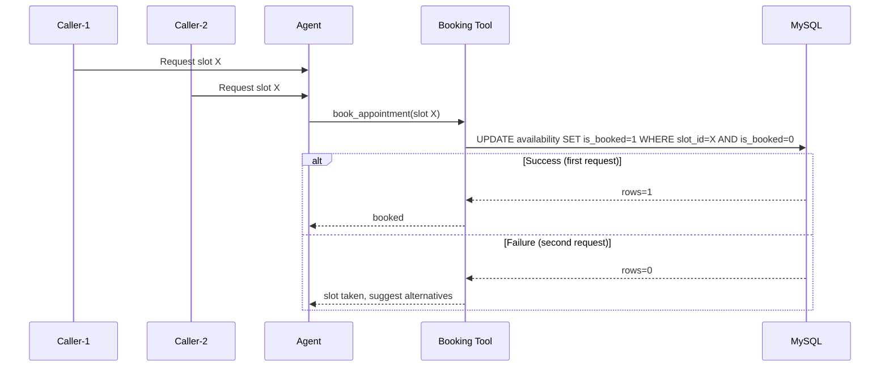
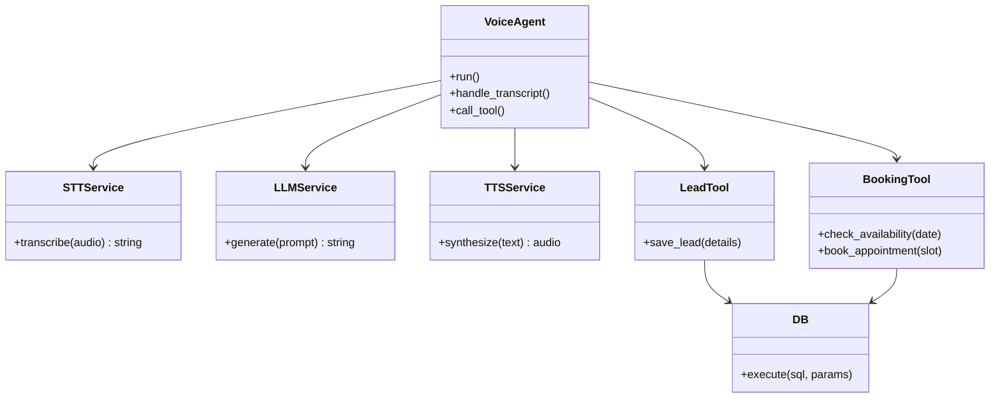

# System Diagrams

## DFD Level 0 (Context Diagram)

> **Explanation:** The context diagram shows the AI Sales Voice Agent as the central process. It receives audio from the Customer, sends it to the STT service, processes the transcript with the LLM, and returns audio via TTS. All lead and booking data flow to/from the MySQL CRM.

## DFD Level 1 (Detailed Processes)

> **Explanation:** This diagram expands the agent into concrete modules that exist in the codebase (`speech_to_text`, `agent_reasoning`, `knowledge_retrieval`, `lead_tool`, `booking_tool`). Data stores include the in‑memory session cache, the vector DB (Chroma), and the MySQL tables.

## UML Use‑Case Diagram
```mermaid
usecaseDiagram
    actor Customer
    actor "Showroom Manager" as Manager
    Customer --> (Speak with Agent)
    (Speak with Agent) --> (Ask product question)
    (Speak with Agent) --> (Share lead details)
    (Speak with Agent) --> (Book showroom visit)
    (Speak with Agent) --> (End call & get summary)
    Manager --> (View leads and summaries)
    Manager --> (View appointments)
```
> **Explanation:** Actors are the Customer and the internal Showroom Manager. The major use‑cases capture the full conversational flow and the managerial view of stored data.

## UML Sequence Diagram – One Full Call

> **Explanation:** Shows the exact function calls (`search_knowledge`, `save_lead`, `check_availability`, `book_appointment`, `summarize_call`) that the code executes during a typical call.

## UML Sequence Diagram – Double‑Booking Race

> **Explanation:** The atomic `UPDATE … WHERE is_booked = 0` guarantees that only the first concurrent request succeeds; the second receives a fallback suggestion.

## UML Class Diagram (Core Classes)

> **Explanation:** Lists the main Python classes (or modules) that implement the agent’s workflow, showing their responsibilities and database dependency.

## Component Diagram (Deployment View)
```mermaid
graph LR
    subgraph "Client"
        Browser[Web Browser]
    end
    subgraph "Server"
        StreamlitApp[Streamlit UI]
        Agent[VoiceAgent Process]
        DB[MySQL]
        Redis[Redis (session cache)]
        Chroma[ChromaDB]
    end
    Browser -->|HTTP/WebSocket| StreamlitApp
    StreamlitApp --> Agent
    Agent -->|SQL| DB
    Agent -->|Cache| Redis
    Agent -->|Vector| Chroma
    Agent -->|API| STT[Groq STT]
    Agent -->|API| LLM[Groq LLM]
    Agent -->|API| TTS[edge‑tts]
```
> **Explanation:** Shows how the front‑end (Streamlit) talks to the back‑end agent, which in turn uses external APIs and internal data stores. This is the basis for the production design described in `ARCHITECTURE.md`.
