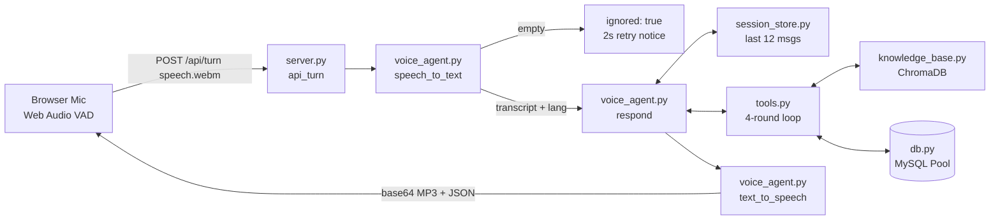

# Fortivex AI Interview Preparation Guide — Comfort Chairs Voice Agent (Aria)

> Written strictly from the real code in this repository (`Python 3.13.15`). Anything not present in the code is marked **not confirmed** or **design only**.

---

## 1. The Email, Decoded

### What Fortivex AI Asked For
- **Round 3 (Advanced AI Project Challenge & Technical Discussion):** Build and demo an **Autonomous AI Sales Voice Agent** that handles live voice calls (English & Hindi), retrieves product knowledge (RAG), qualifies leads, books showroom appointments, saves call summaries, and comes with a 1-page report (`README.md`) and architecture diagram.
- **Round 4 (Individual Technical & 1:1 Interview):** Deep-dive into your code, system design for **1,00,000 users**, security, unit economics, live debugging, and live coding changes on the spot.

### Requirements Traceability Table

| Requirement from Email | Status | File & Function / Endpoint | How to Demo in < 30 Seconds |
| :--- | :--- | :--- | :--- |
| Real-time voice with STT and TTS | **Done** | `server.py` (`api_turn`), `voice_agent.py` (`speech_to_text`, `text_to_speech`), `static/index.html` (`loop`, `playB64`) | Start `uvicorn server:app --port 8000`, click **Start call**, speak into mic, hear Aria reply. |
| Contextual memory | **Done** | `session_store.py` (`append_message`, `get_messages`), `voice_agent.py` (`respond`) | Ask about a chair in Turn 1, then say *"under 15,000 rupees"* in Turn 2 without repeating the product. |
| Multilingual (English & Hindi) | **Done** | `voice_agent.py` (`speech_to_text`, `respond`, `VOICES`), `prompts.py` (`get_system_prompt`) | Speak English, then switch to Hindi (*"कल के लिए कौन-से स्लॉट खाली हैं?"*); Aria mirrors the language. |
| Lead qualification & sentiment analysis | **Done** | `tools.py` (`save_lead`, `normalize_indian_phone`), `summarize_call.py` (`summarize_call`) | Share name, 10-digit phone, and budget; click **End call** to see `lead_status` and `sentiment`. |
| RAG knowledge retrieval | **Done** | `knowledge_base.py` (`search_knowledge`), `build_index.py` (`build_index`), `tools.py` | Ask *"What ergonomic chairs do you have for back pain?"* and check the **Retrieved knowledge** panel. |
| Appointment booking & CRM integration | **Partial** | `db.py` (`save_or_update_lead`, `get_free_slots_for_date`, `book_appointment_atomic`), `tools.py` | MySQL acts as the CRM (`leads`, `appointments`, `availability_slots`). External CRM sync (HubSpot/Salesforce) is **design only**. |
| Call summarisation & business insights | **Done** | `summarize_call.py` (`summarize_call`), `server.py` (`api_end`), `sql/insights.sql` | Click **End call** to generate & save the summary; run `sql/insights.sql` for analytics. |
| One complete end-to-end workflow | **Done** | `POST /api/start` → `POST /api/turn` → `POST /api/end` → `GET /api/db` | Run the 2-minute demo script (Section 15) from greeting to booked slot & summary. |
| System architecture diagram | **Done** | `docs/ARCHITECTURE.md` (MVP + 100k Mermaid diagrams); `docs/DIAGRAMS.md` | Open `docs/ARCHITECTURE.md` on GitHub (`Architecture_Diagram.pdf` must be exported/added manually). |
| Scalability for 1,00,000 users | **Design only** | `docs/ARCHITECTURE.md` (Section 2), `docs/INTERVIEW_PREP.md` (Section 9) | Walk through the sizing formula, stateless workers, Redis, Kafka/Celery, and bottlenecks. |
| Security, infrastructure, deployment & costs | **Partial** | `db.py`, `tools.py`, `.env.example`, `docs/ARCHITECTURE.md` | Parameterized SQL, `.env` secrets, backend `session_id`, and input validation are **Done**; TLS/SRTP, rate limiting, K8s, and cost figures are **Design only**. |
| Live coding & debugging readiness | **Done** | `docs/INTERVIEW_PREP.md` (Sections 12 & 13) | Show modular files (`prompts.py`, `tools.py`, `db.py`, `voice_agent.py`) ready for fast edits. |
| 1-page report in repository | **Done** | `README.md` (370 words, under 450-word limit) | Open `README.md` in GitHub root. |

---

## 2. What We Built & 60-Second Spoken Pitch

**In 3 sentences:**
We built **Aria**, an autonomous bilingual (English and Hindi) AI voice sales assistant for Comfort Chairs that runs hands-free in the browser. It listens using browser Voice Activity Detection, transcribes speech with Groq Whisper, answers catalog questions via ChromaDB RAG and qualifies leads or books showroom slots in MySQL using LLM tool calling, and speaks back with `edge-tts`. When the call ends, it saves a structured summary with sentiment and lead status to MySQL, which acts as our live CRM.

**60-Second Spoken Pitch:**
> "Showrooms lose sales every day because customers call after hours or wait too long for a human sales rep. To solve this, I built **Aria**, a hands-free bilingual AI voice sales agent for Comfort Chairs using Python, FastAPI, Groq, ChromaDB, and MySQL. When a caller speaks in English or Hindi, the browser detects speech automatically and sends `speech.webm` audio to FastAPI. Groq's Whisper Large v3 transcribes it and detects the language, and a Groq-hosted LLM (`qwen/qwen3.8-27b`) uses tool calling to search our ChromaDB product catalog, save the lead, check showroom slots, and book an appointment atomically in MySQL. Aria speaks back naturally using `edge-tts` while the browser mutes the mic during playback so there is no echo. As a result, a caller goes from inquiry to a confirmed showroom booking and a saved CRM summary in under two minutes without any human intervention."

---

## 3. How I Built It, Step by Step

1. **Thin Voice Loop (`03f00b8`):** Built `voice_agent.py` with `speech_to_text` (Groq Whisper) and `text_to_speech` (`edge-tts`). *Lesson:* Always handle Windows event-loop quirks (`WindowsSelectorEventLoopPolicy`) and filter Whisper silence hallucinations early.
2. **Brain & Session Memory (`5e94b29`):** Added `session_store.py` (thread-safe in-memory chat history keyed by `session_id`) and `prompts.py` (Aria's persona, language mirroring, and phone read-back rule). *Lesson:* Keeping `session_store` behind a tiny interface (`get_messages`, `append_message`) makes swapping to Redis easy later.
3. **Multilingual RAG (`b3dbf99`):** Created `data/knowledge.json`, `build_index.py`, and `knowledge_base.py` using ChromaDB and `paraphrase-multilingual-MiniLM-L12-v2`. *Lesson:* Multilingual embeddings let Hindi callers match English product descriptions.
4. **MySQL CRM & Atomic Booking (`45130d3`):** Built `data/schema.sql`, `setup_db.py`, `seed_slots.py`, `db.py` (`MySQLConnectionPool`), and `tools.py` (`save_lead`, `check_availability`, `book_appointment`). *Lesson:* Never rely on "read-then-update" for bookings; use a single atomic `UPDATE ... WHERE is_booked = 0`.
5. **Post-Call Summaries (`summarize_call.py`):** Extracted and validated structured JSON (`summary`, `sentiment`, `lead_status`, `next_action`) and stored it in `call_summaries`. *Lesson:* Always match SQL queries to the live `DESCRIBE table` schema.
6. **Hands-Free FastAPI UI (`server.py`, `static/index.html`, `d6e5228`):** Built FastAPI endpoints and a browser Web Audio API VAD loop while keeping `app.py` (Streamlit) as a fallback UI. *Lesson:* Continuous hands-free voice needs client-side audio state management, whereas Streamlit reruns the whole script on every turn.

---

## 4. Tech Stack Table

| Component | Technology & Version (Real) | Why Chosen | Production Alternative |
| :--- | :--- | :--- | :--- |
| **Language** | Python `3.13.15` | Fast AI/web development | Python `3.12`/`3.13` in Docker |
| **Web API & Server** | `fastapi==0.165.0`, `uvicorn==0.54.0`, `python-multipart==0.0.34` | Clean REST + file upload (`UploadFile`), serves static HTML | FastAPI + WebSockets behind Nginx / Envoy |
| **Fallback UI** | `streamlit>=1.37.0` (`app.py`) | Quick push-to-talk prototype & live DB sidebar | React / Next.js ops dashboard |
| **Browser Audio / VAD** | Web Audio API (`AudioContext`, `AnalyserNode`) + `MediaRecorder` | Zero-dependency hands-free speech detection & half-duplex | WebRTC (LiveKit / Daily) |
| **STT** | Groq `whisper-large-v3` (`groq==1.7.0`) | Fast, accurate English & Hindi transcription | Streaming Deepgram Nova-2 or self-hosted Whisper |
| **LLM** | Groq `qwen/qwen3.8-27b` (`GROQ_CHAT_MODEL`) | Low latency, fluent Devanagari Hindi, reliable tool calling | Multi-provider LLM gateway with fallback |
| **TTS** | `edge-tts==7.3.1` (`en-IN-NeerjaNeural`, `hi-IN-SwaraNeural`) | Natural Indian English & Hindi voices at zero cost | Streaming ElevenLabs / Cartesia / Azure TTS |
| **RAG / Vector DB** | `chromadb==1.5.9` + `sentence-transformers==6.3.0` (`paraphrase-multilingual-MiniLM-L12-v2`) | Local persistent vector store with cross-lingual EN/HI search | Qdrant / Milvus / pgvector + dedicated embedding service |
| **Database / CRM** | MySQL 8.0 (`mysql-connector-python==26.10.0`) | ACID transactions for atomic slot booking | Managed MySQL primary + read replicas + ProxySQL |
| **Config** | `python-dotenv==1.2.4` | Loads `.env` without hardcoding secrets | AWS Secrets Manager / HashiCorp Vault |

---

## 5. System Architecture Explained in Words

**Definition:** *Architecture* is how the parts of the system talk to each other.

**How ONE voice turn flows:**
1. In `static/index.html`, `loop()` reads microphone loudness every animation frame via `analyser.getFloatTimeDomainData(buf)`.
2. When loudness exceeds the calibrated threshold `thr` for `120 ms`, `startRec()` records `audio/webm`. When the user goes quiet for `1000 ms`, `onRecStop()` sends `session_id` and `speech.webm` via `POST /api/turn`.
3. In `server.py`, `api_turn()` reads the uploaded bytes and calls `speech_to_text(audio_bytes, filename=upload_filename)` in `voice_agent.py`.
4. `speech_to_text()` sends `(filename, audio_bytes)` to Groq `whisper-large-v3`, filters silence (`no_speech_prob > 0.6` or `SILENCE_HALLUCINATIONS`), and returns `(transcript, language, elapsed)`. If empty, `api_turn()` returns `{"ignored": true}` and `static/index.html` shows *"Did not catch that, please try again"* for 2 seconds.
5. Otherwise, `api_turn()` calls `respond(session_id, transcript, detected_language=language)` in `voice_agent.py`. `respond()` saves the message in `session_store.py`, sends the last 12 messages to Groq `qwen/qwen3.8-27b`, and executes up to 4 tool rounds (`execute_tool_call` in `tools.py`) hitting `knowledge_base.py` (ChromaDB) or `db.py` (MySQL).
6. `api_turn()` then calls `text_to_speech(reply_text, language=language)` in `voice_agent.py`, base64-encodes the MP3 bytes via `_audio_bytes()`, and returns JSON with `transcript`, `language`, `reply_text`, `reply_audio`, and `timings`.
7. `static/index.html` displays the messages, plays the audio with `playB64()` (ignoring the mic while speaking), and returns to `listening`.



> Note: `docs/Architecture_Diagram.pdf` holds the printable version with the 1,00,000-user production design (currently missing from `docs/` — export/add it before the interview; see `docs/ARCHITECTURE.md` for the 1,00,000-user Mermaid diagram).

---

## 6. Concepts I Must Explain Well

1. **STT & TTS (Speech-to-Text & Text-to-Speech):**
   - *Definition:* STT turns sound waves into text; TTS turns text into spoken audio.
   - *Analogy:* A stenographer typing what a caller says (STT), and a newsreader reading the reply script aloud (TTS).
   - *In my code:* `voice_agent.py` uses Groq `whisper-large-v3` in `speech_to_text()` (returning `(transcript, language, elapsed)`) and `edge-tts` in `text_to_speech()` (returning `(audio_bytes, elapsed)` with `en-IN-NeerjaNeural` or `hi-IN-SwaraNeural`).

2. **LLM System Prompt & Conversation Memory with Session IDs:**
   - *Definition:* A system prompt sets the AI's rules and persona; session memory stores past turns per caller ID.
   - *Analogy:* A call-center script plus a sticky-note pad labeled with the caller's ticket number.
   - *In my code:* `prompts.py` (`get_system_prompt()`) injects today's date, language rules, and phone read-back rules. `session_store.py` stores per-`session_id` messages under a `threading.Lock`, and `respond()` sends the last `MAX_HISTORY_MESSAGES = 12` turns.

3. **Tool / Function Calling & Tool Loop:**
   - *Definition:* Instead of guessing facts or writing SQL directly, the LLM outputs a structured JSON request to run a backend function.
   - *Analogy:* A salesperson checking the stock binder or asking the booking desk before promising a slot.
   - *In my code:* `tools.py` defines `TOOLS_SCHEMA` (`search_knowledge`, `save_lead`, `check_availability`, `book_appointment`) and `execute_tool_call()`. `respond()` in `voice_agent.py` loops up to `MAX_TOOL_ROUNDS = 4` so Aria can chain `save_lead` → `check_availability` → `book_appointment`.

4. **RAG (Chunking, Embeddings, Vector Search, Multilingual):**
   - *Definition:* Retrieval-Augmented Generation fetches relevant facts from a database before the LLM answers. Chunking splits data into small pieces; embeddings turn text meaning into numbers; vector search finds the closest pieces.
   - *Analogy:* Using a smart index to pull only the 4 relevant catalog cards instead of reading the whole binder.
   - *In my code:* `build_index.py` chunks each product and FAQ from `data/knowledge.json` into ChromaDB using `paraphrase-multilingual-MiniLM-L12-v2`. Multilingual embeddings map Hindi and English queries to the same vector space, so `search_knowledge(query, top_k=4)` works in both languages.

5. **Lead Qualification & Sentiment via Structured JSON + Validation:**
   - *Definition:* Extracting fixed fields (`sentiment`, `lead_status`, `summary`) from a free-text conversation and validating allowed values.
   - *Analogy:* Filling out a standardized CRM feedback form after hanging up.
   - *In my code:* `prompts.py` (`SUMMARIZE_PROMPT`) asks the LLM for JSON only. `summarize_call.py` strips markdown fences (`_strip_fences`), parses JSON, validates `sentiment` (`Positive`/`Neutral`/`Negative`) and `lead_status` (`Willing`/`Not Willing`/`Needs Follow-up`) in `_validate()`, and persists to MySQL `call_summaries`.

6. **Atomic Booking & Race Conditions:**
   - *Definition:* A race condition happens when two users try to book the same slot at the same millisecond. An atomic update does the check and the lock in one database step.
   - *Analogy:* Two hands reaching for the last concert ticket; the box office hands it to the first one and immediately marks it sold.
   - *In my code:* `book_appointment_atomic()` in `db.py` runs `UPDATE availability_slots SET is_booked = 1 WHERE slot_date = %s AND slot_time = %s AND is_booked = 0` inside a transaction. If `cur.rowcount == 0`, it rolls back and returns `slot_unavailable`.

7. **Connection Pooling:**
   - *Definition:* Reusing a pool of open database connections instead of opening and closing a TCP connection on every query.
   - *Analogy:* Keeping 15 delivery scooters fueled at the shop instead of buying a new scooter for every order.
   - *In my code:* `db.py` creates `pooling.MySQLConnectionPool(pool_name="mypool", pool_size=15, ...)` at startup and `_get_conn()` retries briefly on `PoolError`.

8. **VAD, WebM Audio & Half-Duplex Echo Control:**
   - *Definition:* Voice Activity Detection (VAD) detects when someone starts and stops speaking; `webm` is the browser's compressed audio container; half-duplex means only one side speaks at a time.
   - *Analogy:* A walkie-talkie that automatically transmits when your voice is louder than room noise and mutes your mic while the other person talks.
   - *In my code:* `static/index.html` computes RMS mic loudness (`level()`), calibrates room noise after `450 ms`, records `audio/webm` (`speech.webm`), and sets `state = "speaking"` during `playB64()` so `loop()` ignores the mic until `350 ms` after Aria finishes.

9. **Why FastAPI + HTML Replaced Streamlit for Hands-Free:**
   - *Definition:* Streamlit reruns the entire Python script from top to bottom on every widget interaction.
   - *Analogy:* Refreshing a whole webpage every time you say one sentence vs. keeping a live phone line open.
   - *In my code:* `app.py` (Streamlit) works as a push-to-talk fallback UI, while `server.py` (FastAPI) + `static/index.html` keeps the `AudioContext` and `MediaRecorder` alive continuously without page reloads.

---

## 7. Challenges We Faced & How We Solved Them (Verified Only)

1. **Silent SQLite fallback (`db.py`):**
   - *Symptom:* Data went into `local.db` while MySQL stayed empty.
   - *Root Cause:* Earlier fallback code silently used SQLite when MySQL failed.
   - *Fix:* Made `db.py` MySQL-only with `MySQLConnectionPool` and loud errors on missing env vars or connection failures.
   - *Lesson:* Never hide database failures behind silent fallbacks.
2. **Summary `INSERT` column & placeholder mismatch (`db.py`, `test_db.py`, `summarize_call.py`):**
   - *Symptom:* `ProgrammingError: Unknown column 'appointment_booked'` and `Not all parameters were used` (`?` vs `%s`).
   - *Root Cause:* The live `call_summaries` table has `(session_id, summary, sentiment, lead_status, next_action)`, while `test_db.py` used `?` placeholders and `summarize_call.py` initially only ran `SELECT`.
   - *Fix:* Aligned `db.py`, `test_db.py`, and `summarize_call.py` to `%s` placeholders and the real `call_summaries` columns.
   - *Lesson:* Always check `DESCRIBE <table>` against every `INSERT` query.
3. **`tts()` returning a tuple (`voice_agent.py`, `server.py`):**
   - *Symptom:* Audio encoding fails if `(bytes, float)` is passed to `base64.b64encode()`.
   - *Root Cause:* `text_to_speech()` returns `(audio_bytes, elapsed_seconds)`.
   - *Fix:* Added `_audio_bytes(result)` in `server.py` to safely extract the `bytes` element.
   - *Lesson:* Check function return types at module boundaries.
4. **MySQL date/time values not JSON-serializable (`server.py`):**
   - *Symptom:* `/api/db` crashed serializing `datetime.date` and `datetime.timedelta` from `availability_slots`.
   - *Root Cause:* `mysql-connector-python` returns native `date`/`timedelta` objects.
   - *Fix:* Added `_safe(data)` in `server.py` using `json.dumps(data, default=str)`.
   - *Lesson:* Convert DB-specific types before returning JSON responses.
5. **Browser audio was `webm` while STT assumed WAV, plus tuple bug (`voice_agent.py`, `server.py`):**
   - *Symptom:* Browser orb went `Hearing you` → `Thinking` → `Listening` silently with no reply.
   - *Root Cause:* `server.py` treated `stt()`'s 3-tuple return as a `dict` (`.get("text")`), always getting `""` → `{"ignored": true}`; `speech_to_text()` also hardcoded `"caller_audio.wav"`.
   - *Fix:* Unpacked the tuple in `server.py`, added optional `filename` parameter to `speech_to_text()`, and added a 2-second *"Did not catch that"* notice in `static/index.html`.
   - *Lesson:* Never silently swallow or ignore empty states in the UI.
6. **Suspended `AudioContext`, calibration pollution, and self-echo (`static/index.html`):**
   - *Symptom:* Browser mic can read silence if `AudioContext` is suspended, or calibrate on Aria's greeting / hear its own playback.
   - *Root Cause:* Browsers suspend `AudioContext` until user gesture, and speakers bleed into the mic.
   - *Fix:* Added explicit `ctx.resume()`, `calibrateDelayMs: 450`, `afterSpeakMs: 350`, and `state !== "listening"` check in `loop()`.
   - *Lesson:* Browser voice UIs need explicit state gating around audio playback.
7. **Slots going stale after midnight (`seed_slots.py`):**
   - *Symptom:* Old seeded dates fall into the past when the date rolls over.
   - *Root Cause:* Slots are seeded for `today .. today + 6`.
   - *Fix:* `seed_slots.py` uses `INSERT ... ON DUPLICATE KEY UPDATE id=id` so it is safe to re-run daily without duplicates.
   - *Lesson:* Make seed scripts idempotent.
8. **Connection pool exhaustion under parallel booking (`db.py`):**
   - *Symptom:* 10 simultaneous booking attempts threw `PoolError: Failed getting connection; pool exhausted`.
   - *Root Cause:* `pool_size=5` with non-blocking `get_connection()`.
   - *Fix:* Increased `pool_size=15` and added a retry loop in `_get_conn()`.
   - *Lesson:* Load-test connection pools with concurrent threads.
9. **Duplicate LLM call in `respond()` & verifying AI fixes (`voice_agent.py`):**
   - *Symptom:* Every tool loop round called Groq LLM twice, doubling token usage and causing 429 timeouts.
   - *Root Cause:* An automated patch left a duplicate `client.chat.completions.create()` block inside `respond()`.
   - *Fix:* Removed the duplicate block and verified every fix by running real end-to-end API tests.
   - *Lesson:* Always run real tests after editing code; never trust a description of a fix without output.

*(Note: `server.py` importing `execute_query`, stale pooled reads, and Streamlit `0.0s` rerun timings are **not confirmed** in the current code or git log.)*

---

## 8. Business Understanding

- **The Problem:** Showrooms miss after-hours calls, take too long to reply to leads, and spend expensive SDR (Sales Development Representative) hours answering basic catalog/timing questions.
- **End-to-End Workflow:** Greet → Understand needs (RAG) → Capture lead (`save_lead`) → Check availability (`check_availability`) → Book showroom visit (`book_appointment`) → Summarize call & score sentiment (`summarize_call`).
- **Why AI Voice Helps:** Instant 24/7 response in English and Hindi, consistent qualification, and zero manual CRM data entry.
- **Unit Economics Formula (no invented prices — check current Groq/TTS/telephony pricing pages):**

$$\text{Cost per Call Minute} = \text{STT}_{\text{min}} + \text{LLM}_{\text{min}} + \text{TTS}_{\text{min}} + \text{Telephony}_{\text{min}} + \frac{\text{Monthly Infra}}{\text{Total Monthly Call Minutes}}$$

- **Comparing vs. Human SDR:**

$$\text{Cost per Qualified Lead (AI)} = \frac{\text{Total AI Cost (period)}}{\text{Qualified Leads Booked (period)}}$$

Compare directly against $\frac{\text{Human SDR Salary + Overhead (period)}}{\text{Qualified Leads Booked by SDR (period)}}$.
- **Key Risks:**
  1. *STT errors on phone numbers:* Mitigated by `prompts.py` spaced digit read-back and `normalize_indian_phone()` in `tools.py`.
  2. *Price hallucination:* Mitigated by `search_knowledge` RAG tool.
  3. *Language mix-ups (Hinglish):* Mitigated by Whisper auto-detect + multilingual embeddings.
  4. *Call recording consent:* Must add upfront verbal disclosure in production.

---

## 9. Scalability to 1,00,000 Users

- **Daily Users vs. Concurrent Calls (Sizing Method):**

$$\text{Average Concurrent Calls} = \frac{\text{Calls per Day} \times \text{Average Call Minutes}}{1440}$$

$$\text{Peak Concurrent Calls} = \text{Average Concurrent Calls} \times \text{Peak Factor}$$

- **Target Production Architecture (Design Only):**
  - **Telephony:** Twilio Media Streams / SIP trunking into a media gateway.
  - **Transport:** WebSockets or WebRTC for streaming audio instead of REST blob uploads.
  - **Compute:** Stateless FastAPI workers behind a load balancer, autoscaled on CPU/active WebSockets (Kubernetes HPA).
  - **Session Memory:** Redis cluster replacing the Python dict in `session_store.py`.
  - **Async Writes:** Kafka or Celery queue for non-blocking lead updates and post-call summaries.
  - **Vector DB & Embeddings:** Sharded Qdrant/Milvus + dedicated embedding inference service + prompt/FAQ caching.
  - **Relational DB:** MySQL primary (atomic bookings) + read replicas (dashboards) + ProxySQL.
- **What Breaks First at 1,00,000 Users & Fixes:**
  1. *LLM & STT rate limits (429):* Fix with multi-key/multi-provider LLM gateway, circuit breakers, and self-hosted Whisper/vLLM.
  2. *DB connections:* Fix with ProxySQL/RDS Proxy, read replicas, and async write queues.
  3. *Embedding model RAM:* Fix by moving `SentenceTransformer` out of each API worker into a single shared embedding service.
- **What in MY Code Already Follows These Rules vs. Does Not:**
  - *Already ready:* `session_store.py` (isolated module interface), `db.py` (`execute_write`/`execute_read` + connection pool), `voice_agent.py` & `tools.py` (decoupled from UI), stateless FastAPI routes in `server.py`.
  - *Not ready (MVP only):* `session_store.py` uses an in-process dict, `knowledge_base.py` loads `SentenceTransformer` in-process, `server.py` runs synchronous `def` handlers with REST audio blobs instead of streaming WebSockets, and `summarize_call` runs synchronously on `/api/end`.

---

## 10. Security, Infrastructure, Deployment & Costs

- **Implemented in Code:**
  - Parameterized SQL (`%s`) everywhere in `db.py` (prevents SQL injection).
  - Secrets in `.env` (gitignored) with `.env.example` template.
  - `session_id` injected by `server.py` / `app.py` into `execute_tool_call()`, never trusted from LLM arguments (`tools.py` line 171).
  - Input validation: Indian phone regex (`[6-9]\d{9}`), 7-day booking date window (`validate_iso_date`), allowed `lead_status` and `sentiment` enums, and `get_recent_table_rows()` table allowlist.
  - *Phone masking in logs:* **not confirmed / not implemented** (`debug.log` logs transcripts and `httpx` debug payloads).
- **Production-Only (Design):** TLS 1.3 + SRTP media encryption, API rate limiting, cloud Secrets Manager, least-privilege MySQL user (not `root`), verbal call-recording consent, PII retention/deletion policy, Docker + Kubernetes + CI/CD, and Prometheus/Grafana monitoring.

---

## 11. 35 Likely Interview Questions & Short Answers

**Voice (STT & TTS)**
1. *Why FastAPI for hands-free?* FastAPI keeps a persistent browser Web Audio loop over REST without Streamlit's full-script reruns.
2. *How does your VAD work?* `AnalyserNode` computes RMS volume; speech starts above `max(0.008, min(0.05, noise * 2.0))` for 120 ms and stops after 1000 ms of quiet.
3. *Why half-duplex?* Ignoring the mic while Aria speaks (`afterSpeakMs: 350`) stops speaker echo from triggering self-transcription.
4. *How do you handle silence hallucinations?* `speech_to_text()` checks `no_speech_prob > 0.6` and filters `SILENCE_HALLUCINATIONS` (e.g., `"thank you for watching"`).
5. *How would you cut latency?* Stream audio over WebSockets to streaming STT, stream LLM tokens, and stream TTS sentence-by-sentence.

**LLM & Agents**
6. *Why tool calling instead of if-else rules?* Callers jump between questions, objections, and booking; tool calling lets the LLM decide when to search RAG or write to MySQL.
7. *How are infinite tool loops prevented?* `MAX_TOOL_ROUNDS = 4` in `respond()`.
8. *How are invented prices prevented?* `prompts.py` forces Aria to call `search_knowledge` for all product/price questions.
9. *What if Groq returns empty content?* `respond()` retries on empty content+tools and has a bilingual fallback string at the end.
10. *Why `qwen/qwen3.8-27b`?* Fast latency on Groq, strong Hindi Devanagari output, and reliable tool calling (unlike reasoning models that exhausted `max_tokens` on internal thinking).
11. *How do you add a 3rd language like Punjabi?* Add `"pa"` to `VOICES` in `voice_agent.py`, map `"punjabi"`/`"pa"` in `speech_to_text()`, and add a Punjabi directive in `respond()`.

**RAG**
12. *Why ChromaDB?* Zero-setup local persistent vector store for the MVP.
13. *Why `paraphrase-multilingual-MiniLM-L12-v2`?* Maps Hindi and English queries into the same vector space.
14. *How is the knowledge base chunked?* One chunk per chair model and one per FAQ in `build_index.py` with `price` and `category` metadata.
15. *How many chunks are retrieved?* `top_k = 4` in `knowledge_base.py`.
16. *What is a weakness of your RAG?* Pure semantic search struggles with exact numeric filters like `"under 5000 rupees"` unless combined with metadata filtering.

**Database**
17. *How is double booking prevented?* `book_appointment_atomic()` runs `UPDATE availability_slots SET is_booked = 1 WHERE ... AND is_booked = 0` inside a transaction and checks `cur.rowcount == 0`.
18. *Why remove SQLite fallback?* Silent fallback caused split-brain data in `local.db` while MySQL stayed empty.
19. *What happens when STT mishears a phone number?* Aria reads it back in spaced digits (`prompts.py`) and `normalize_indian_phone()` rejects invalid 10-digit numbers (`tools.py`).
20. *Why `pool_size=15` + retry?* Prevents `PoolError` during concurrent bookings.
21. *How does `save_or_update_lead` avoid losing data?* It reads the existing row for `session_id` and only overwrites non-empty fields.

**System Design**
22. *What breaks at 1,00,000 users?* LLM/STT 429 rate limits, in-memory `session_store`, MySQL connections, and per-worker embedding RAM.
23. *How do you scale `session_store`?* Replace the Python dict with Redis keyed by `session_id` with a TTL.
24. *Why a message queue for summaries?* Summarization is post-call work and shouldn't block live voice workers.
25. *How do you connect real phone calls?* Twilio Media Streams / SIP over WebSockets feeding a voice worker.
26. *How do you size workers?* `(Calls/day * Avg minutes / 1440) * Peak factor`.

**Business & Behavioural**
27. *What is the business ROI?* 24/7 instant lead qualification and showroom booking at lower cost per qualified lead than manual SDRs.
28. *How do you track business insights?* `call_summaries`, `leads`, and `appointments` queried via `sql/insights.sql`.
29. *What if a user is not interested?* Aria sets `lead_status='Not Willing'` and closes politely.
30. *How would you test this agent?* Automated `py_compile` + `node --check`, `test_db.py`, end-to-end `edge-tts` API tests (`/api/start`, `/api/turn` EN/HI/silent, `/api/end`), and a 10-thread booking race test.
31. *How did you use AI tools responsibly?* Reviewed every edit, rejected silent fallbacks, and verified every fix by running real commands and checking live MySQL rows.
32. *What would you build next?* Streaming WebSockets with barge-in, Redis session memory, metadata price filtering in RAG, and Twilio phone integration.
33. *Biggest bug you fixed?* `server.py` calling `.get("text")` on `speech_to_text()`'s 3-tuple return, which silently ignored every browser turn.
34. *Why keep `app.py`?* As a reliable push-to-talk fallback UI if browser VAD has mic issues during a demo.
35. *What is the main compliance risk?* Recording/transcribing calls without upfront user consent.

---

## 12. 15 Likely Live Coding Change Requests

| # | Change Request | Exact File & Function to Edit | How to Test |
| :--- | :--- | :--- | :--- |
| 1 | Add a field (e.g. `city`) to `leads` | `db.py` (`_init_schema`, `save_or_update_lead`), `tools.py` (`TOOLS_SCHEMA`, `execute_tool_call`) | `ALTER TABLE leads ADD city VARCHAR(64)`, call `save_lead` via `/api/turn`, check `GET /api/db`. |
| 2 | Change showroom slot hours | `seed_slots.py` (`weekday_hours`, `sunday_hours`) | Run `python seed_slots.py` and query `availability_slots`. |
| 3 | Add a 3rd language (e.g. Punjabi) | `voice_agent.py` (`VOICES`, `speech_to_text`, `respond`), `server.py` (`_lang`) | POST a Punjabi TTS clip to `/api/turn` and check `language` & `reply_text`. |
| 4 | Switch the LLM model | `.env` (`GROQ_CHAT_MODEL`), `voice_agent.py` (`GROQ_CHAT_MODEL`), `summarize_call.py` | Restart `uvicorn` and run one `/api/turn` + `/api/end`. |
| 5 | Add a new tool (e.g. `cancel_appointment`) | `tools.py` (`TOOLS_SCHEMA`, `execute_tool_call`), `db.py` (new atomic cancel helper) | Ask Aria to cancel a booking and verify `is_booked = 0`. |
| 6 | Change the opening greeting | `server.py` (`api_start` → `greeting_text`), `prompts.py` (`GREETINGS`) | `POST /api/start` and inspect `greeting_text`. |
| 7 | Adjust VAD sensitivity / silence timeout | `static/index.html` (`CFG.marginX`, `CFG.minThreshold`, `CFG.endSilenceMs`) | Run `node --check` on the script and test in browser. |
| 8 | Add a product to catalog & re-index | `data/knowledge.json`, then run `python build_index.py` | Ask Aria about the new chair and check `search_knowledge`. |
| 9 | Change Aria's persona or rules | `prompts.py` (`get_system_prompt`) | Run `/api/turn` and verify the reply follows the new rule. |
| 10 | Add a new endpoint (e.g. `/api/health`) | `server.py` (add `@app.get("/api/health")` above `app.mount("/", ...)`) | `curl http://127.0.0.1:8000/api/health`. |
| 11 | Show a new column in the demo panel | `static/index.html` (`showTurn`, `refreshDb`) or `server.py` (`api_db`) | Reload `http://127.0.0.1:8000` and inspect Live MySQL rows. |
| 12 | Change max booking window (7 → 14 days) | `tools.py` (`validate_iso_date` → `timedelta(days=14)`) | Call `check_availability` for 10 days ahead. |
| 13 | Change conversation history length | `voice_agent.py` (`MAX_HISTORY_MESSAGES = 12`) | Send 15 turns and verify context window size. |
| 14 | Add a new silence hallucination phrase | `voice_agent.py` (`SILENCE_HALLUCINATIONS`), `server.py` (`_SILENCE_PHRASES`) | Test with a clip containing that phrase → returns `ignored: true`. |
| 15 | Mask phone numbers in logs | `voice_agent.py` / `server.py` (regex mask `\b[6-9]\d{9}\b` before logging) | Check `debug.log` after a turn with a phone number. |

---

## 13. Debugging Playbook for a Live Round

**First 3 things to check when anything fails:**
1. Terminal running `uvicorn` + `Get-Content debug.log -Tail 30`
2. Browser DevTools Console (`F12`) & Network tab (`/api/turn` status & JSON)
3. `.env` values (`GROQ_API_KEY`, `MYSQL_PASSWORD`) and MySQL service status (`Get-Service MySQL*`)

**Stage-by-Stage Playbook:**
- **Mic / VAD:** Check `#dbg` mic level in `static/index.html`; ensure `audio running` (not `suspended`) and `lv > thr` when speaking.
- **STT:** Check `debug.log` for `STT request: filename=speech.webm` and `STT done: transcript=...`; verify `GROQ_API_KEY`.
- **LLM:** Check `debug.log` for `429 Too Many Requests` or `Groq chat completion failed`; verify `GROQ_CHAT_MODEL`.
- **Tool Call / RAG:** Run `python -c "import knowledge_base; print(knowledge_base.search_knowledge('office chair'))"` to confirm ChromaDB & `sentence-transformers` work.
- **Database:** Run `python test_db.py` and `python inspect_db.py`; confirm `MySQL80` is running.
- **TTS:** Check `debug.log` for `reply_audio_bytes > 0`; test `python -m edge_tts --text "hello" --write-media test.mp3`.

---

## 14. Known Limitations (State Honestly)

1. Loudness-based VAD (`level()`) can trigger on loud background noise.
2. Half-duplex only: caller cannot interrupt Aria mid-sentence.
3. Whole-blob upload per turn (`speech.webm`) instead of streaming audio/TTS (adds ~3–4 s turn latency).
4. In-memory `session_store.py` clears active chat history if `uvicorn` restarts.
5. No real PSTN/SIP telephony bridge (browser mic only).
6. Semantic RAG search alone is weak on strict numeric filters (e.g., *"under 5000 rupees"* relies on the LLM reading retrieved prices).
7. LLM tool-calling can occasionally be non-deterministic (e.g., confirming a booking in text without emitting `book_appointment` if the prompt/user phrasing is ambiguous).

---

## 15. Demo Script, Fallback Plan & < 1 Minute Startup

**Start Everything in Under 1 Minute:**
```powershell
cd C:\Users\hp\Desktop\Automated_caller_System
.venv\Scripts\activate
uvicorn server:app --port 8000
```
Open `http://127.0.0.1:8000` in Chrome/Edge and allow the microphone.

**2-Minute Demo Script (English → Hindi):**
1. Click **Start call** → hear Aria's English greeting.
2. *(English)* Say: *"I need an ergonomic office chair for 8 hours of daily sitting, under 15,000 rupees."* → show RAG recommendation.
3. *(Hindi)* Say: *"कल के लिए कौन-से स्लॉट खाली हैं?"* → show Hindi response + `check_availability`.
4. *(English)* Give name & 10-digit phone, confirm the read-back, and pick an available slot → show `save_lead` + `book_appointment`.
5. Click **End call** → show Call Summary card (`sentiment`, `lead_status`, `next_action`) and Live MySQL rows.

**Fallback Plan:**
- *Venue Wi-Fi fails:* Switch to mobile hotspot immediately.
- *Browser VAD mic fails:* Run `streamlit run app.py` (push-to-talk fallback UI).
- *Groq API outage:* Play pre-recorded backup demo video and walk through live MySQL rows + code.

---

## 16. Interview-Day Checklist (From Email)

- [ ] Reporting: **26 Nov 2026 at 8:30 AM**, Venue: **32-313**
- [ ] Dress code: **Formals**
- [ ] Laptop + charger with the working project & MySQL running
- [ ] Public GitHub repository link ready
- [ ] Printed Architecture Diagram (`docs/Architecture_Diagram.pdf` — export & print)
- [ ] 2 copies of Resume + 2 passport photographs
- [ ] College ID card
- [ ] Academic transcripts & Government ID (original + photocopy)
- [ ] Google Form submission completed

---

## 17. 10-Minute Last-Hour Revision Sheet (20 Key Points)

1. **Product:** Aria, bilingual (EN/HI) AI voice sales agent for Comfort Chairs (15 chairs in `data/knowledge.json`).
2. **Primary UI:** `uvicorn server:app --port 8000` (`server.py` + `static/index.html`); fallback UI: `streamlit run app.py`.
3. **4 Endpoints:** `POST /api/start`, `POST /api/turn`, `POST /api/end`, `GET /api/db`.
4. **STT:** Groq `whisper-large-v3` in `voice_agent.py` (`speech_to_text`), accepts `filename="speech.webm"`.
5. **TTS:** `edge-tts` (`en-IN-NeerjaNeural`, `hi-IN-SwaraNeural`), returns `(bytes, elapsed)`.
6. **LLM:** Groq `qwen/qwen3.8-27b` (`respond()`), `MAX_TOOL_ROUNDS = 4`, `MAX_HISTORY_MESSAGES = 12`.
7. **4 LLM Tools (`tools.py`):** `search_knowledge`, `save_lead`, `check_availability`, `book_appointment`.
8. **RAG (`knowledge_base.py`):** ChromaDB + `paraphrase-multilingual-MiniLM-L12-v2`, `top_k = 4`.
9. **CRM (`db.py`):** MySQL-only `MySQLConnectionPool` (`pool_size=15`) with 4 tables: `leads`, `availability_slots`, `appointments`, `call_summaries`.
10. **Atomic Booking:** `UPDATE availability_slots SET is_booked = 1 WHERE ... AND is_booked = 0` (`rowcount == 0` → `slot_unavailable`).
11. **Phone Validation:** `normalize_indian_phone()` (`[6-9]\d{9}`) + spaced digit read-back in `prompts.py`.
12. **Date Validation:** `validate_iso_date()` enforces `today .. today + 7 days`.
13. **Security Done:** Parameterized SQL (`%s`), `.env` secrets, backend-injected `session_id`.
14. **VAD & Echo Control:** Web Audio RMS threshold + `450 ms` calibration delay + half-duplex (`afterSpeakMs: 350`).
15. **Silent Turn UX:** `/api/turn` returns `{"ignored": true}` on silence → UI shows *"Did not catch that, please try again"* for 2 s.
16. **Summary:** `summarize_call.py` calls Groq with `SUMMARIZE_PROMPT`, validates enums, writes `call_summaries`, updates `leads.lead_status`.
17. **100k Sizing Formula:** `(Calls/day × Avg Minutes / 1440) × Peak Factor`.
18. **100k Architecture:** Stateless FastAPI/WebSocket workers + Redis + Kafka/Celery + sharded Vector DB + MySQL primary/replicas + Twilio/SIP + K8s.
19. **First Bottlenecks at Scale:** Groq 429 rate limits, DB connections, per-pod embedding RAM.
20. **Unit Economics Formula:** `STT/min + LLM/min + TTS/min + Telephony/min + (Monthly Infra / Total Monthly Minutes)`.
